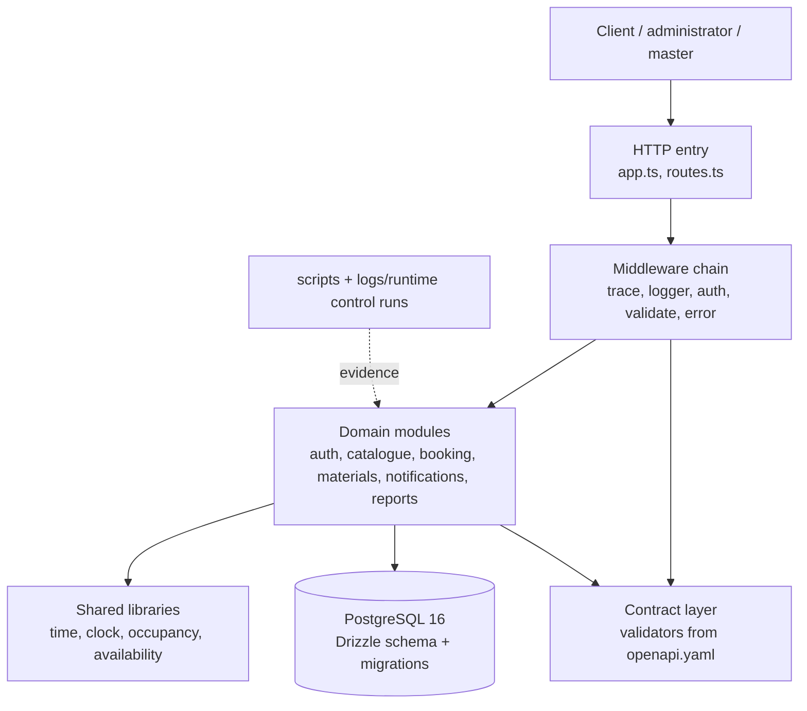

# Components of the Salon Management System API

| | |
|---|---|
| Ticket | SMS-47 (documentation) |
| Source of truth | `spec/api/openapi.yaml` (50 operations, 58 schemas, 16 error codes) |
| Implementation | `src/` — one module per component, one component per contract area |
| Tests | `tests/api/*` (one file per component), `tests/structural`, `tests/acceptance` |

The system is one Node process. "Component" here means a module with a stated
responsibility and a boundary that can be tested on its own — not a deployable
service. The split follows the contract's four audiences, because that is the
boundary the API already draws.

---

## 1. The picture

## 2. The components

| # | Component | Files | Responsibility | Depends on |
|---|---|---|---|---|
| 1 | **Entry and app factory** | `src/index.ts`, `src/app.ts`, `src/config.ts`, `src/routes.ts` | Builds the app (no I/O), injects the clock, mounts the chain, owns the socket and the reminder scheduler | all modules |
| 2 | **HTTP plumbing** | `src/middleware/*` | Trace ids, JSONL access log, authentication (`jose` HS256), body/query/param validation, RFC 9457 `Problem` rendering, 404 | contract layer |
| 3 | **Contract layer** | `src/contract/*`, `scripts/convert.*` | Turns `openapi.yaml` into AJV validators and a path→template index; generates `openapi.json` | `spec/api/openapi.yaml` |
| 4 | **Persistence** | `src/db/schema.ts`, `src/db/client.ts`, `src/db/migrations/` | Tables, constraints, one pool; deterministic migrations 0000–0008 | PostgreSQL |
| 5 | **Authentication** | `src/modules/auth/*` | A1–A4: login, refresh, logout, `me` | 2, 4 |
| 6 | **Reference data** | `src/modules/{masters,catalog,master-services,units,reference-data}` | R1–R18, P1–P6, M1–M4: masters, services, categories, units, master↔service links, preferences | 2, 3, 4 |
| 7 | **Booking** | `src/modules/appointments/{routes,service,reschedule,state,rules,view,staff-view,lookup,admin,admin-actions,payments}.ts`, `src/modules/public/*` | P7–P11, R19–R23, R25–R27: create, read, reschedule, cancel, complete, administrator edit and payment | 2, 3, 4, 8 |
| 8 | **Materials** | `src/modules/materials/*` | R14–R16, R26: catalogue of consumables and the stock ledger | 2, 3, 4 |
| 9 | **Notifications** | `src/modules/notifications/{reminders,cancellation,scheduler,service,routes,preferences}.ts` | R24, M5–M7, and the reminder engine: rows at booking, dispatch on read, the process tick, settlement on cancellation | 2, 3, 4, 7 |
| 10 | **Reports** | `src/modules/reports/{period,service,routes}.ts` | R28–R30: revenue, popular services, stock levels | 2, 3, 4 |
| 11 | **Shared libraries** | `src/lib/{time,clock,occupancy,availability}.ts` | Kyiv formatting, the request clock, the 30-minute rounding and occupancy arithmetic, availability windows | — |
| 12 | **Test harness** | `tests/helpers`, `tests/setup.ts`, `tests/manifest.json`, `scripts/check-test-first.mjs` | Fixtures, truncation, the test↔implementation manifest, the causality check | 4 |
| 13 | **Evidence** | `scripts/verify-contract.mjs`, `logs/runtime/*.mjs` | Contract presence, and one control script per stage that runs the built artifact against a scratch database | 1 |

## 3. Why these boundaries

| Boundary | Reason |
|---|---|
| **Contract layer separate from handlers** | The validator is generated, not written; keeping it out of the modules is what makes "the contract is the source" checkable (`npm run verify:contract`) |
| **`lib/` separate from `modules/`** | Rounding, occupancy, formatting and the clock are pure and are tested through the operations that use them; a module that imported another module's helper would couple two audiences |
| **`state.ts` as a pure table** | The allowed transitions of `error-model.md` §3.1 live in one function, so P10, P11, R21, R22 and R23 cannot disagree about them |
| **Routes thin, services fat** | A handler decides *which* HTTP answer a result means; the service decides *what* happened. That is why the same `editAppointment` serves P11 and R21 |
| **The scheduler in `index.ts`, not `app.ts`** | A timer belongs to the process; a test app must be able to build the app without one (stage R gate §5) |
| **One module per audience** | The contract is grouped by who may call it; the code mirrors that so an authorisation change has one place to live |

## 4. Cross-cutting decisions that shape the split

| Decision | Where it shows |
|---|---|
| D-6 — own JSONL logger, no logging framework | `src/middleware/logger.ts`; sample in `logs/samples/` |
| D-9 — the clock is injected | `createApp({ now })`, `nowOf(req)` in `src/lib/clock.ts` |
| D-7 — tests truncate a `_test` database | `tests/setup.ts` refuses a database name without the suffix |
| One error model — `Problem` for every failure | `src/middleware/error-handler.ts`; no handler writes its own error body |
| Instants leave the API in salon time | `salonDateTime` from `src/lib/time.ts`, used by the view mappers |

## 5. Where each component is tested

| Component | Tests |
|---|---|
| Entry, plumbing, contract | `tests/api/structural.test.ts`, `tests/api/auth.test.ts`, `tests/structural/*` |
| Authentication | `tests/api/auth.test.ts` |
| Reference data | `tests/api/reference-data.test.ts`, `public-catalogue.test.ts`, `availability.test.ts`, `notification-preferences.test.ts` |
| Booking | `tests/api/booking.test.ts`, `appointment-payments.test.ts`, `cancellation.test.ts`, `confirmation.test.ts`, `master-calendar.test.ts`, `reschedule.test.ts`, `rounding.test.ts`, `admin-appointment-actions.test.ts`, `admin-appointments.test.ts`, `occupancy.test.ts` |
| Materials | `tests/api/material-transactions.test.ts` |
| Notifications | `tests/api/reminders.test.ts`, `reminder-scheduler.test.ts`, `cancelled-reminders.test.ts`, `notification.test.ts`, `my-notifications.test.ts` |
| Reports | `tests/api/reports.test.ts` |
| NFRs | `tests/acceptance/nfr.test.ts` |
