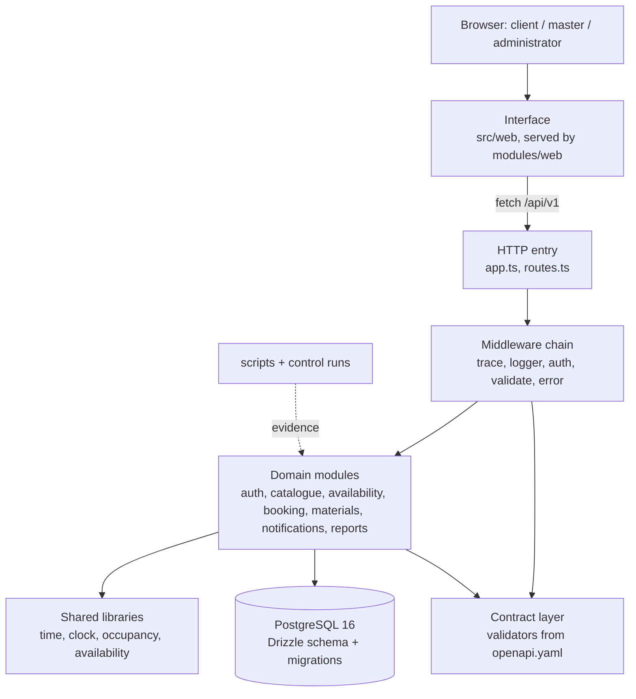

# Components of the Salon Management System

| | |
|---|---|
| Tickets | SMS-47 (first version), SMS-61 (lab 6: the interface, the operation map from the code, the references) |
| Sources of truth | `spec/api/openapi.yaml` (50 operations, 58 schemas, 16 error codes); `spec/ui/screens.md` (19 page routes) |
| Implementation | `src/` — one module per component; `src/web/` — the interface |
| Tests | `tests/api/*` and `tests/acceptance/*` (Vitest, 412 cases), `tests/ui/*` (Playwright, 51 cases) |
| References | `docs/api/index.html` (the contract, Redocly), `docs/reference/server/` and `docs/reference/web/` (the code, TypeDoc) — §6 |

The system is one Node process. "Component" here means a module with a stated
responsibility and a boundary that can be tested on its own — not a deployable
service. The split follows the contract's audiences, because that is the
boundary the API already draws; the interface is one more client of that
contract, served by the same process.

---

## 1. The picture

## 2. The components

The operations column is derived from the code: each id is the
`resource-model.md` §5 operation whose path and method the module registers
(checked for all 50 operations, 2026-11-27).

| # | Component | Files | Operations and responsibility | Depends on |
|---|---|---|---|---|
| 1 | **Entry and app factory** | `src/index.ts`, `src/app.ts`, `src/config.ts`, `src/routes.ts` | Builds the app (no I/O), injects the clock, mounts the chain, the API and the interface; `index.ts` owns the socket and the reminder scheduler | all modules |
| 2 | **HTTP plumbing** | `src/middleware/*` | Trace ids, JSONL access log, authentication (`jose` HS256), body/query/param validation, RFC 9457 `Problem` rendering with the cause chain logged (SMS-75), 404/405 | 3 |
| 3 | **Contract layer** | `src/contract/*` (`convert.mjs`, `validators.ts`, `paths.ts`) | Turns `openapi.yaml` into AJV validators and a path→template index; generates `openapi.json` | `spec/api/openapi.yaml` |
| 4 | **Persistence** | `src/db/schema.ts`, `src/db/client.ts`, `src/db/migrations/` | Tables, constraints, one pool; deterministic migrations 0000–0008 | PostgreSQL |
| 5 | **Authentication** | `src/modules/auth/*` | **A1** login, **A2** `me` | 2, 4 |
| 6 | **Public catalogue** | `src/modules/public/*` | **P1–P6**: services, categories, masters, a master's prices — active rows only, the administrator excluded | 2, 3, 4 |
| 7 | **Reference data** | `src/modules/{masters,catalog,master-services,units,reference-data}` | **R1–R4** masters, **R5–R9** services and categories, **R10–R12** master↔service prices, **R17** units, **M2** my services | 2, 3, 4 |
| 8 | **Availability** | `src/modules/availability/*` | **P7** free slots, **M3–M4** a master's weekly and date rules | 2, 3, 4, 11 |
| 9 | **Booking** | `src/modules/appointments/*` | **P8–P11** book, read, cancel, reschedule by token; **M1** my calendar; **R18–R20** list, create, read; **R21–R23** edit, cancel, complete; **R27** payment | 2, 3, 4, 8, 10 |
| 10 | **Notifications** | `src/modules/notifications/*` | **M5–M7** preferences and my notifications, **R24** an appointment's notifications; the reminder engine: rows at booking, the process tick, settlement on cancellation | 2, 3, 4, 9 |
| 11 | **Shared libraries** | `src/lib/{time,clock,occupancy,availability}.ts` | Kyiv formatting, the request clock, the 30-minute rounding and occupancy arithmetic, availability windows | — |
| 12 | **Materials** | `src/modules/materials/*` | **R13–R16** materials, **R25–R26** the stock ledger | 2, 3, 4 |
| 13 | **Reports** | `src/modules/reports/*` | **R28–R30** revenue, popular services, stock levels | 2, 3, 4 |
| 14 | **Interface — server side** | `src/modules/web/routes.ts` | Serves the HTML shell for the 19 page paths of `screens.md` §3 and the built assets under `/assets/`; any other path reaches the API's 404 | — |
| 15 | **Interface — browser** | `src/web/{main,staff,api,offers,format,dom}.ts`, `src/web/screens/*`, `index.html`, `styles.css` | The screens C1–C3, S1, M1–M3, N1–N2, A1–A9; calls only `/api/v1` | the contract, through 1 |
| 16 | **Test harness** | `tests/helpers`, `tests/setup.ts`, `tests/manifest.json`, `tests/ui/support`, `scripts/check-test-first.mjs` | Fixtures, truncation, the test↔implementation manifest, the causality check, the browser tests' own database | 4 |
| 17 | **Evidence** | `scripts/verify-contract.mjs`; control-run scripts in `logs/runtime/` (git-ignored, see the README) | Contract presence; one control script per stage of lab 5 that ran the built artifact against a scratch database | 1 |

## 3. Why these boundaries

| Boundary | Reason |
|---|---|
| **Contract layer separate from handlers** | The validator is generated, not written; keeping it out of the modules is what makes "the contract is the source" checkable (`npm run verify:contract`) |
| **`lib/` separate from `modules/`** | Rounding, occupancy, formatting and the clock are pure and are tested through the operations that use them; a module that imported another module's helper would couple two audiences |
| **`state.ts` as a pure table** | The allowed transitions of `error-model.md` §3.1 live in one function, so P10, P11, R21, R22 and R23 cannot disagree about them |
| **Routes thin, services fat** | A handler decides *which* HTTP answer a result means; the service decides *what* happened. That is why the same `editAppointment` serves P11 and R21 |
| **The scheduler in `index.ts`, not `app.ts`** | A timer belongs to the process; a test app must be able to build the app without one (stage R gate §5) |
| **One module per audience** | The contract is grouped by who may call it; the code mirrors that so an authorisation change has one place to live |

## 4. Cross-cutting decisions that shape the split

| Decision | Where it shows |
|---|---|
| D-6 — own JSONL logger, no logging framework | `src/middleware/logger.ts`; sample in `logs/samples/` |
| D-9 — the clock is injected | `createApp({ now })`, `nowOf(req)` in `src/lib/clock.ts` |
| D-7 — tests truncate a `_test` database | `tests/setup.ts` refuses a database name without the suffix |
| One error model — `Problem` for every failure | `src/middleware/error-handler.ts`; no handler writes its own error body |
| Instants leave the API in salon time | `salonDateTime` from `src/lib/time.ts`, used by the view mappers |

## 5. Where each component is tested

| Component | Tests |
|---|---|
| Entry, plumbing, contract | `tests/api/structural.test.ts`, `tests/api/error-log.test.ts`, `tests/api/confirmation-url.test.ts` |
| Authentication | `tests/api/auth.test.ts` |
| Public catalogue | `tests/api/public-catalogue.test.ts` |
| Reference data | `tests/api/reference-data.test.ts`, `admin-masters-role.test.ts`, `master-service-references.test.ts` |
| Availability | `tests/api/availability.test.ts` |
| Booking | `tests/api/booking.test.ts`, `appointment-payments.test.ts`, `cancellation.test.ts`, `confirmation.test.ts`, `master-calendar.test.ts`, `reschedule.test.ts`, `rounding.test.ts`, `admin-appointment-actions.test.ts`, `admin-appointments.test.ts`, `occupancy.test.ts` |
| Materials | `tests/api/material-transactions.test.ts` |
| Notifications | `tests/api/reminders.test.ts`, `reminder-scheduler.test.ts`, `cancelled-reminders.test.ts`, `notification.test.ts`, `my-notifications.test.ts`, `notification-preferences.test.ts` |
| Reports | `tests/api/reports.test.ts` |
| NFRs | `tests/acceptance/nfr.test.ts` |
| Interface | `tests/ui/*.spec.ts` (Playwright): `client-booking`, `confirmation`, `reschedule`, `responsive`, `staff-auth`, `master`, `admin`, `time-format`, `review` |

## 6. References

| Reference | What it is | Built by |
|---|---|---|
| `docs/api/index.html` | The REST API — every operation, schema, error and example of `openapi.yaml`, the lab 4 contract | `npm run docs:api` (Redocly `build-docs`) |
| `docs/reference/server/index.html` | The server code: every exported function, type and constant, from its TSDoc comment | `npm run docs:code` (TypeDoc, `typedoc.json`) |
| `docs/reference/web/index.html` | The interface code, the same way | `npm run docs:code` (TypeDoc, `src/web/typedoc.json`) |

`npm run docs` rebuilds all three. They are committed, so they can be read
without building anything; regenerate them in the same commit as a change to
the contract or to a doc comment. The API page is pre-rendered and readable
offline; its search and collapsing load Redoc's script from Redocly's CDN.
TypeDoc's validation is strict: an exported function, class, interface, type
or constant without a doc comment fails the build, as `npm run lint` does.

## 7. Change history

| Date | Change | Ticket |
|---|---|---|
| 2026-11-13 | First version | SMS-47 |
| 2026-11-27 | The interface (components 14–15); the operations column derived from the code, which corrected the authentication row ("A1–A4: login, refresh, logout, me" — the contract has A1 and A2) and the ranges of five other rows; the availability and public-catalogue modules listed; two paths that did not exist (`scripts/convert.*`, `tests/structural`) replaced; §6 references | SMS-61 |
